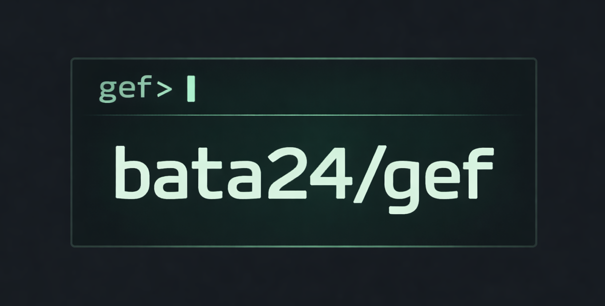

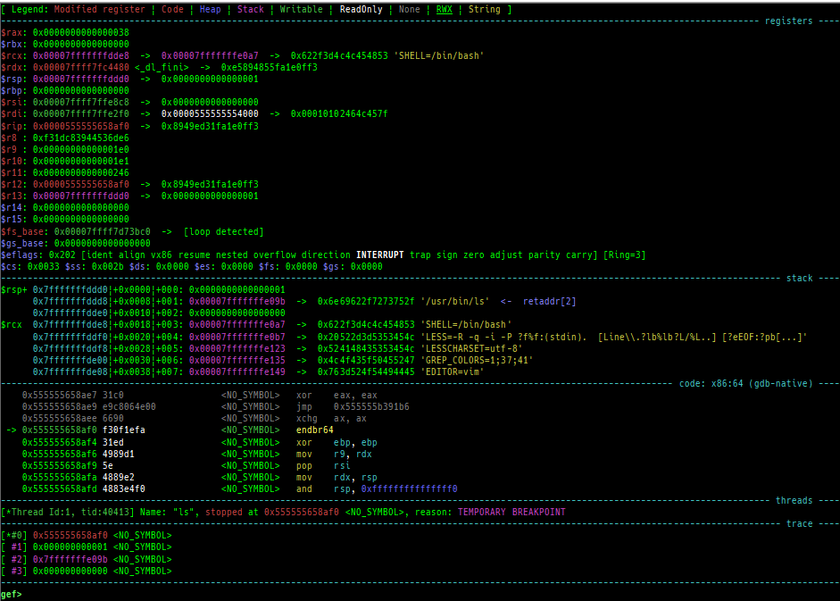

## Table of Contents
- [What Is This?](#what-is-this)
- [Setup](#setup)
    - [Supported Environment](#supported-environment)
    - [Install](#install)
    - [Upgrade](#upgrade)
    - [Uninstall](#uninstall)
    - [Dependencies](#dependencies)
    - [Supported Modes](#supported-modes)
- [Added / Improved Features](#added--improved-features)
    - [Qemu-system/KGDB Cooperation](#qemu-systemkgdb-cooperation)
    - [Heap Dump Features](#heap-dump-features)
    - [Qemu-user Cooperation](#qemu-user-cooperation)
    - [Debugging Support](#debugging-support)
    - [Process Information](#process-information)
    - [Memory](#memory)
    - [Register](#register)
    - [Misc](#misc)
    - [GEF Maintenance](#gef-maintenance)
    - [Other](#other)
- [FAQ](#faq)
- [Links](#links)

## What Is This?
This is a fork of [GEF](https://github.com/hugsy/gef) that includes three major improvements:
1. Adds [heuristic commands for kernel debugging](#qemu-systemkgdb-cooperation) __without requiring a symbolized `vmlinux`__ (for `qemu-system`, supports Linux kernel 3.x-7.0.x).
2. Expands support to [many architectures](docs/QEMU-USER-SUPPORTED-ARCH.md) (for `qemu-user`).
3. Provides [heap dump commands](#heap-dump-features) for multiple memory allocators.

Numerous other commands have been added and enhanced. Enjoy!

## Setup

### Supported Environment
- Recommended: Ubuntu 24.04-26.04, Debian stable, and Arch Linux.
- May work, but not recommended: Ubuntu 20.04-23.10.

### Install
__The installer has been refactored. I recommend re-installing.__ (2026-10-17)

- Run the following command:
    ```bash
    # For various reasons, I recommend installing it as the root user
    wget -q https://raw.githubusercontent.com/bata24/gef/dev/install-uv.sh -O- | sudo sh

    # For non-root user
    wget -q https://raw.githubusercontent.com/bata24/gef/dev/install-uv.sh -O- | sh

    # Install GEF in a different directory
    wget -q https://raw.githubusercontent.com/bata24/gef/dev/install-uv.sh -O- | env GEF_INSTALL_DIR="/path/to/gef" sh
    ```
    - Notes
        - By default, `gef.py` is installed to `$HOME/.gef/gef.py`.
        - The required Python packages are installed to `$HOME/.gef/venv-gef`.
        - The installer selects CPython matching GDB's Python major and minor version.
        - GEF queries the environment at startup; activation is not required.
        - An existing environment with a different Python version must be recreated before installation.
        - GEF's installation directory is registered in `$HOME/.gdbinit`.
        - For more installation options and non-`root` user's limitations, see [docs/FAQ.md](docs/FAQ.md).

- Or, quick trial (no installation):
    ```bash
    wget https://raw.githubusercontent.com/bata24/gef/dev/gef.py
    echo "source $(pwd)/gef.py" >> ~/.gdbinit
    ```
    - Notes
        - Most features work fine even without external tools.
        - Extra Python packages are optional; commands requiring them remain unavailable until installed.

### Upgrade
```bash
python3 "$HOME/.gef/gef.py" --upgrade
```

- Note
    - If you get errors after upgrading, it may be due to old config. Try renaming `$HOME/.gef.rc`.
    - Restart GDB after upgrading. Old `gef.venv.conf` and `skip-venv-check` files are no longer used.
    - If GDB's Python major or minor version changes, recreate `venv-gef` with a matching Python and reinstall its packages.

### Uninstall
```bash
rm -rf "$HOME/.gef"
rm -f "$HOME/.gef.rc"
rm -rf /tmp/gef
sed -i -e '/from gef import/d' "$HOME/.gdbinit"
```

If you used `GEF_INSTALL_DIR`, remove that directory instead of `$HOME/.gef`.

### Dependencies
Please refer to [install-uv.sh](install-uv.sh) for installation requirements.

### Supported Modes
- Standard debugging
- Attaching to a running process
- Attaching to a process in an isolated namespace (e.g., attaching from outside a **Docker** container)
- Connecting to **Gdbserver**
- Connecting to the GDB stub of **Qemu-system**
- Connecting to the GDB stub of **Qemu-user**
- Connecting to the GDB stub of **Intel Pin**
- Connecting to the GDB stub of **Intel SDE**
- Connecting to the GDB stub of **Qiling framework**
- Connecting to the GDB stub of **KGDB** (requires GDB version 12 or later)
- Connecting to the GDB stub of **VMWare**
- Connecting to the GDB stub of **Wine**
- Debugging with **Record and replay** (`rr replay`)

For a comprehensive list and additional details, see [docs/SUPPORTED-MODE.md](docs/SUPPORTED-MODE.md).

## Added / Improved Features

For the usage and options of each command, see [docs/COMMANDS.md](docs/COMMANDS.md).

### Qemu-system/KGDB Cooperation

#### Memory Map

<details open>
<summary><code>pagewalk</code>, <code>kvmmap</code></summary>

- `pagewalk`: dumps page tables.
    - x64 (Supported: 4-Level/5-Level Paging)
        - 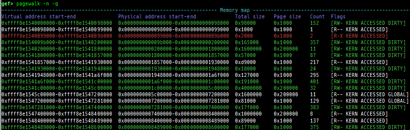
    - x86 (Supported: PAE/Non-PAE)
        - 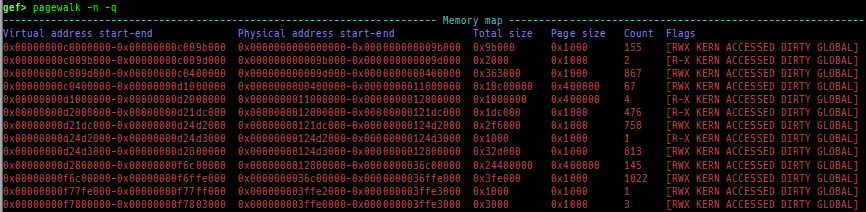
    - ARM64 (Supported: Cortex-A only, EL0-EL3, Stage1-2)
        - ARM v8.7 base. 32bit mode is NOT supported.
        - 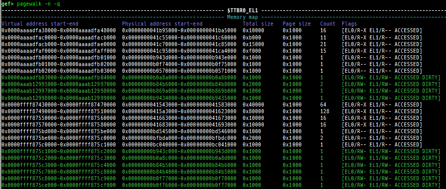
        - Here is a sample of each level pagewalk from HITCON CTF 2018 `super_hexagon`.
        - 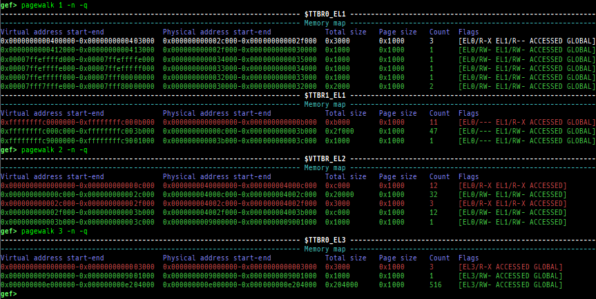
        - Secure memory scanning is also supported, but you have to break in the secure world.
        - 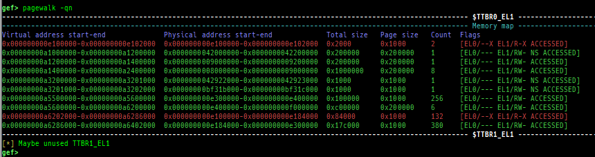
        - Pseudo memory map without detailed flags and permissions can be output even in the normal world (when OP-TEE).
        - 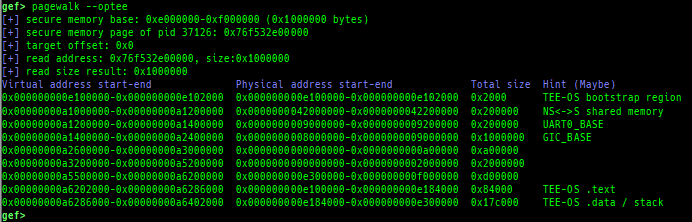
    - ARM (Supported: Cortex-A only, LPAE/Non-LPAE, PL0/PL1)
        - ARM v7 base. PL2 is NOT supported.
        - 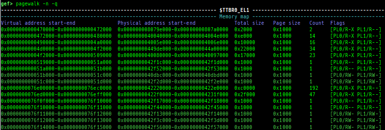
        - Secure memory scanning is also supported, and you don't have to break in the secure world (unlike ARM64).
        - 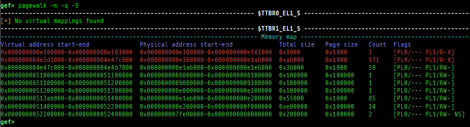
- `kvmmap`: prints kernel memory map.
    - 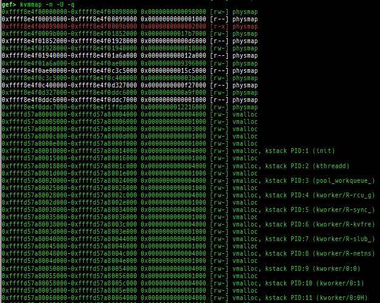

</details>

#### Register

<details>
<summary><code>qreg</code>, <code>msr</code>, <code>cet</code>, <code>vbar</code>, <code>gdtinfo</code>, <code>idtinfo</code>, <code>read-system-register-for-qemu-arm</code>, <code>read-system-register-for-kgdb</code>, <code>switch-el</code></summary>

- `qreg`: displays the register values from qemu-monitor (allows getting values like `$cs` even under qemu 2.x).
    - It is a shortcut for `monitor info registers`.
    - It also prints the details of each bit of the system register when x64/x86.
    - 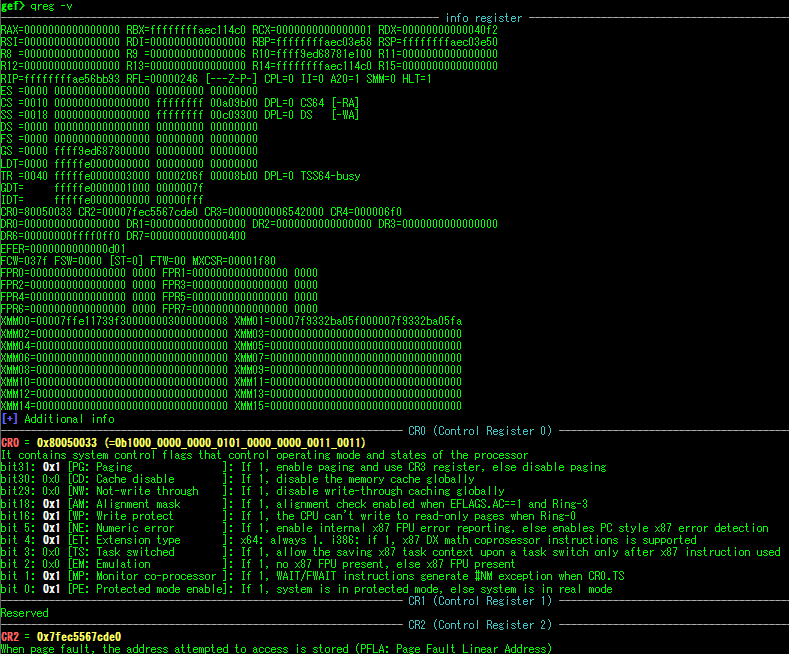
- `msr`: reads/writes MSR (Model Specific Registers) value by embedding/executing dynamic assembly.
    - Supported on x64 and x86.
    - 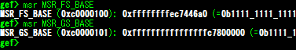
- `cet`: displays Intel CET settings.
- `vbar`: displays ARM/ARM64 vector table.
    - 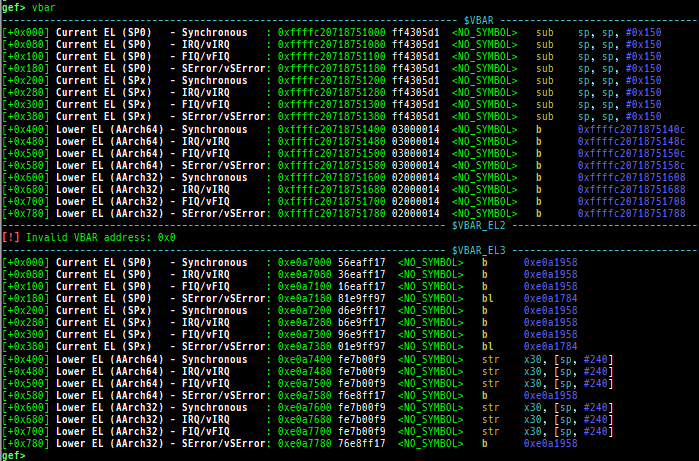
- `gdtinfo`: pretty prints GDT entries. If userland, show sample entries.
    - 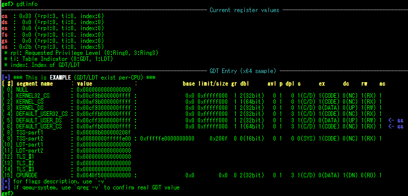
- `idtinfo`: pretty prints IDT entries. If userland, show sample entries.
    - 
- `read-system-register-for-qemu-arm`: reads system register for old `qemu-system-arm`.
- `read-system-register-for-kgdb`: reads system register for kgdb (x64/ARM64 only).
- `switch-el`: switches EL (Exception Level).
    - Supported on ARM64.

</details>

#### Linux Basic

<details>
<summary><code>kbase</code>, <code>kversion</code>, <code>kcmdline</code>, <code>kcurrent</code>, <code>kchecksec</code>, <code>kmagic</code>, <code>kpercpu</code>, <code>ks-selftest</code></summary>

- `kbase`: displays the kernel base address.
- `kversion`: displays the kernel version.
- `kcmdline`: displays the kernel cmdline used at boot time.
- `kcurrent`: displays current task address.
    - 
- `kchecksec`: checks kernel security.
    - 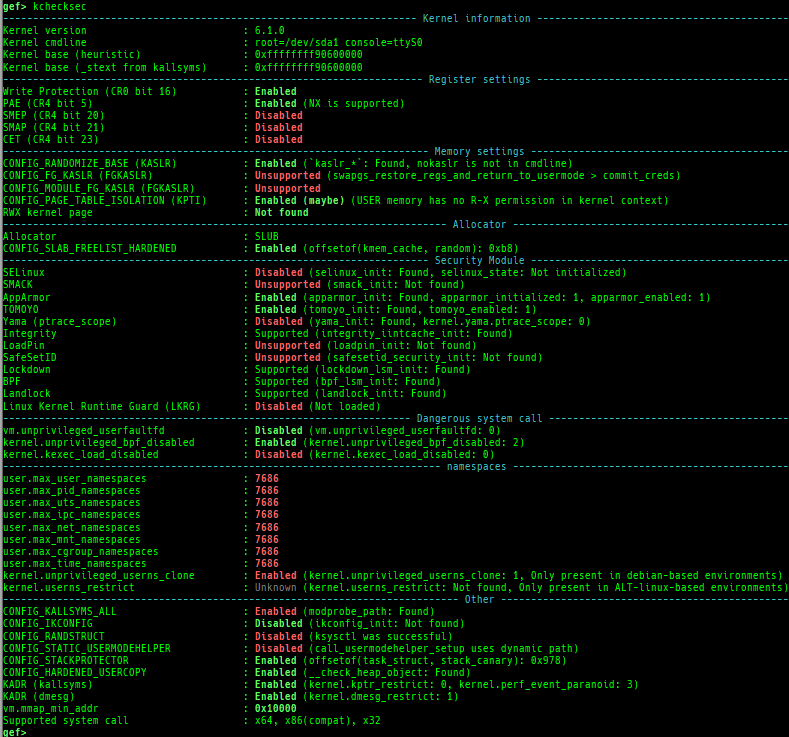
- `kmagic`: displays useful addresses in the kernel.
    - 
- `kpercpu`: resolves the per-cpu variables and the per-cpu areas.
    - 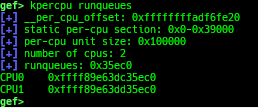
- `ks-selftest`: compares the results of kernel-address heuristic finders with kallsyms.

</details>

#### Virt/Phys/Page

<details>
<summary><code>v2p</code>, <code>p2v</code>, <code>xp</code>, <code>page</code>, <code>slab-virtual</code>, <code>pageinfo</code>, <code>highmem-dump</code></summary>

- `v2p`/`p2v`: displays the transformation between virtual addresses and physical addresses.
    - 
- `xp`: is a shortcut for physical memory dump.
    - 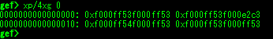
- `page`: displays the transformation between a `struct page` and its virtual/physical address.
    - 
    - There are shortcuts: `virt2page`, `page2virt`, `phys2page` and `page2phys`.
- `slab-virtual`: displays the transformation between slab-meta and its slab-data/`struct page` address (for `CONFIG_SLAB_VIRTUAL=y`).
    - 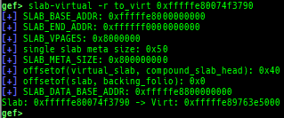
- `pageinfo`: dumps `struct page->{flags,page_type}`.
    - 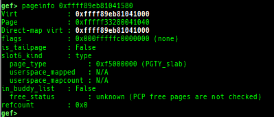
- `highmem-dump`: dumps `HighMem` mappings.
    - 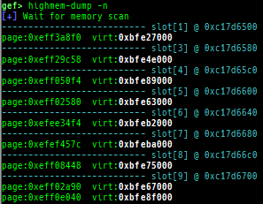

</details>

#### Linux Symbol/Type

<details open>
<summary><code>ksymaddr-remote</code>, <code>ksymaddr-remote-apply</code>, <code>vmlinux-to-elf-apply</code>, <code>ktypes</code>, <code>ktypes-load</code>, <code>kload</code>, <code>kmod-load</code></summary>

- `ksymaddr-remote`: displays kallsyms information from scanning kernel memory.
    - Supported kernel versions: 3.x to 7.0.x.
    - 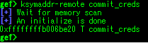
- `ksymaddr-remote-apply`/`vmlinux-to-elf-apply`: applies kallsyms information obtained by `ksymaddr-remote` or `vmlinux-to-elf` to gdb.
    - 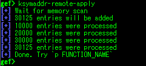
    - 
    - Once you get a symboled pseudo ELF file, you can reuse and apply it automatically even after rebooting qemu-system.
    - `vmlinux-to-elf-apply` and `ksymaddr-remote-apply` provide almost the same functionality.
        - `vmlinux-to-elf-apply`: Requires installation of external tools. Create `vmlinux` with symbols.
        - `ksymaddr-remote-apply`: Requires no external tools. Create a blank ELF with embedded symbols only.
- `ktypes`: displays kernel type information from scanning kernel memory.
    - 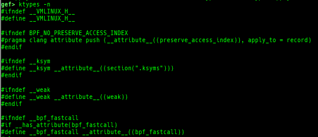
- `ktypes-load`: loads kernel type information from scanning kernel memory.
    - 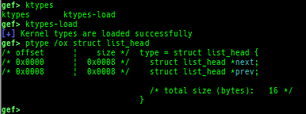
- `kload`: loads `vmlinux` without a load address.
    - It is useful if you have a `vmlinux` with `debuginfo` at hand.
- `kmod-load`: loads the kernel module without a load address.
    - It is useful if you have a kernel module with `debuginfo` at hand.

</details>

#### Linux Task

<details open>
<summary><code>ktask</code>, <code>ksched</code>, <code>kcred</code></summary>

- `ktask`: displays each task's address.
    - 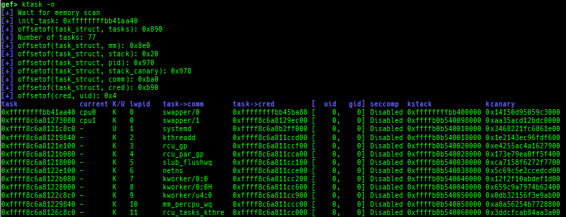
    - It also displays the memory map of the userland process.
    - 
    - It also displays the register values saved on the kstack of the userland process.
    - 
    - It also displays the file descriptors of the userland process.
    - 
    - It also displays the signal handlers of the userland process.
    - 
    - It also displays the namespaces of the userland process.
    - 
    - It also displays the seccomp-filter.
    - 
- `ksched`: dumps the scheduler state of each task (cpu, state, class, priority, policy).
    - 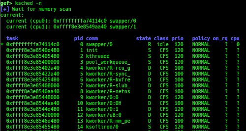
- `kcred`: dumps the credentials of each task.
    - 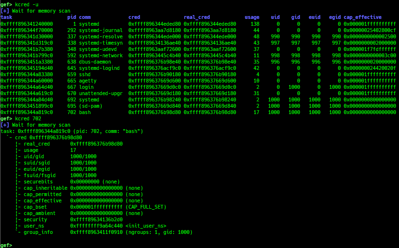

</details>

#### Linux Advanced

<details>
<summary><code>kconfig</code>, <code>ksyscalls</code>, <code>ksysctl</code>, <code>kmod</code>, <code>kops</code>, <code>kcdev</code>, <code>kbdev</code>, <code>kfilesystems</code>, <code>kmount</code>, <code>kclock-source</code>, <code>kdmesg</code>, <code>kpipe</code>, <code>kbpf</code>, <code>ktimer</code>, <code>kpcidev</code>, <code>kipcs</code>, <code>kdevio</code>, <code>kdmabuf</code>, <code>kirq</code>, <code>knetdev</code>, <code>kworkqueue</code>, <code>kwalk</code>, <code>kpath</code>, <code>kvfs</code>, <code>ksock</code>, <code>kskb</code>, <code>klsm</code>, <code>knft</code>, <code>kio-uring</code>, <code>krefs</code>, <code>kkeyring</code></summary>

- `kconfig`: dumps the kernel config if available.
    - 
- `ksyscalls`: displays the system call table.
    - 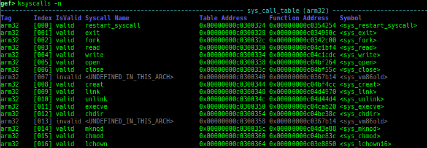
    - It also dumps the ia32/x32 syscall table under x64.
    - It also dumps the compat syscall table under ARM64.
- `ksysctl`: dumps the sysctl parameters.
    - 
- `kmod`: displays each module's address.
    - 
    - It also displays the symbols of each module.
    - 
- `kops`: displays each operation's member.
    - 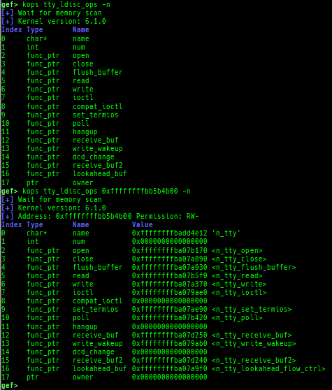
- `kcdev`: displays information for each character device.
    - 
- `kbdev`: displays information for each block device.
    - If there are too many block devices, detection will not be successful.
    - This is because block devices are not managed in one place, so I use the list of `bdev_cache` obtained from the slub-dump results.
    - 
- `kfilesystems`: dumps supported file systems.
    - 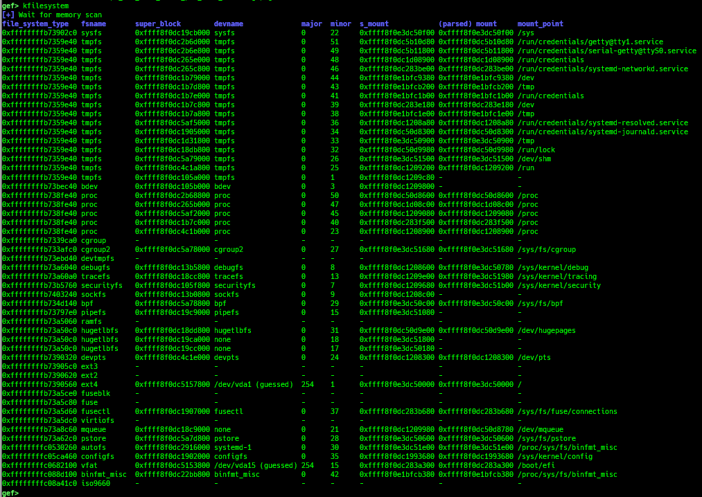
- `kmount`: dumps the mount tree of each mount namespace.
    - 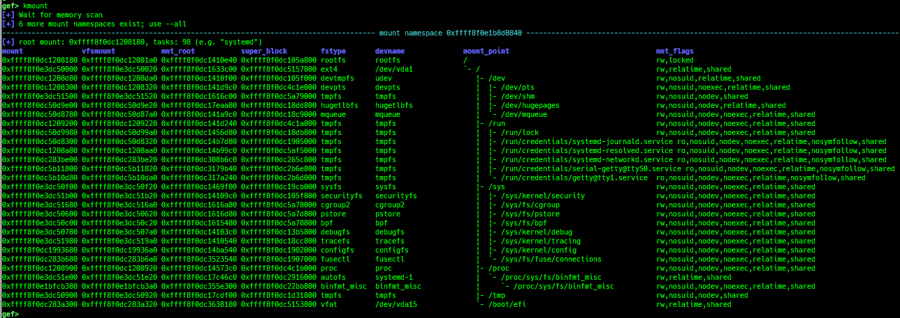
- `kclock-source`: dumps the clocksource list.
    - 
- `kdmesg`: dumps the ring buffer of the dmesg area.
    - 
- `kpipe`: displays information for each pipe.
    - 
- `kbpf`: dumps the BPF information.
    - 
- `ktimer`: dumps the timer.
    - 
- `kpcidev`: dumps the PCI devices.
    - 
- `kipcs`: dumps IPCs information (System V semaphore, message queue and shared memory).
    - 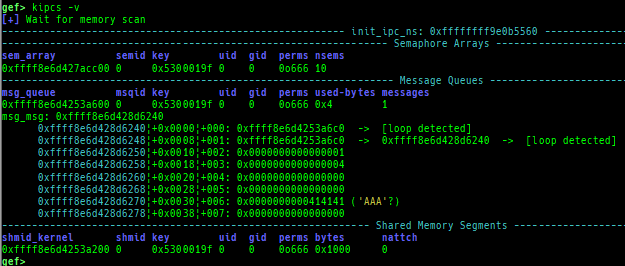
- `kdevio`: dumps I/O-port and I/O-memory information.
    - 
- `kdmabuf`: dumps DMA-BUF information.
    - 
- `kirq`: dumps irq information.
    - 
- `knetdev`: displays net devices.
    - 
- `kworkqueue`: dumps workqueue items and inspects embedded work_struct objects.
    - 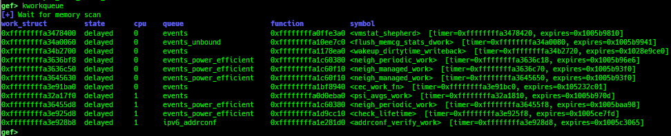
- `kwalk`: dumps the entries held by the well-known kernel data structures.
    - 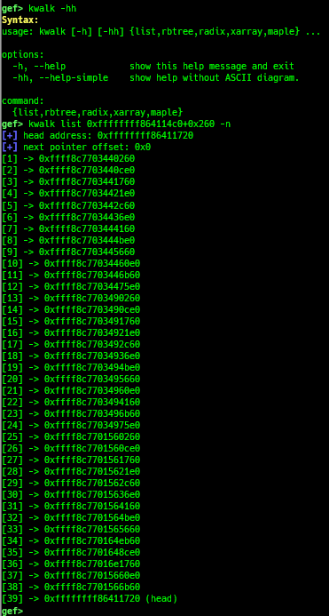
- `kpath`: reconstructs the pathname of a dentry, path, file or mount.
    - 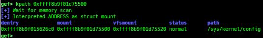
- `kvfs`: displays the VFS object graph of a file descriptor or VFS object.
    - 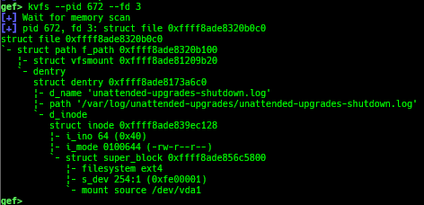
- `ksock`: walks from a file descriptor (or a raw struct sock) through socket, sock and its skb queues.
- `kskb`: parses a single sk_buff and shows its buffer layout, refcount and fragment information.
    - 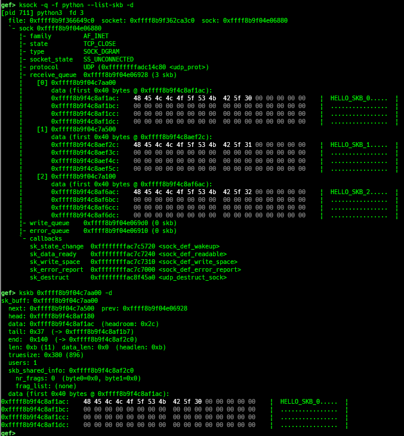
- `klsm`: dumps the registered Linux Security Module hooks.
    - 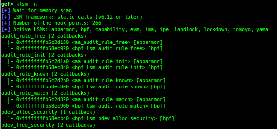
- `knft`: dumps the nftables (netfilter) object graph.
    - 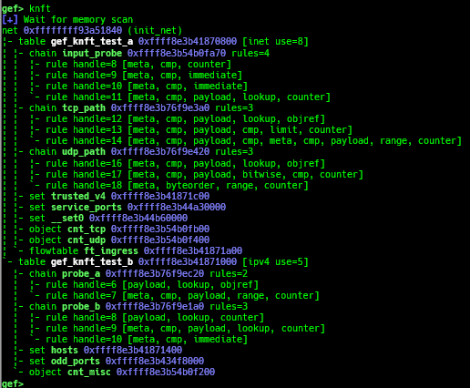
- `kio-uring`: displays the kernel-side io_uring object graph.
    - 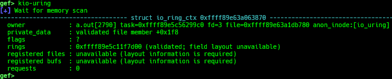
- `krefs`: searches the kernel pointers that reference the specified address.
    - 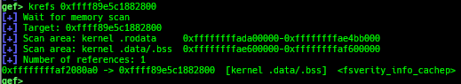
- `kkeyring`: displays the keyrings referenced by tasks, or inspects an arbitrary struct key.
    - 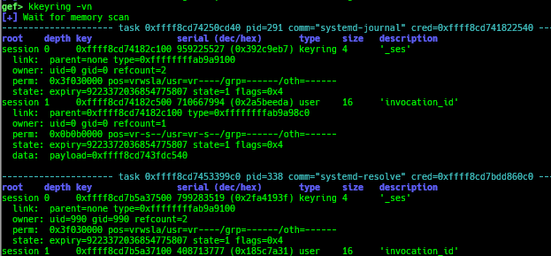

</details>

#### Linux Allocator

<details open>
<summary><code>slub-dump</code>, <code>slab-dump</code>, <code>slob-dump</code>, <code>slub-tiny-dump</code>, <code>slab-contains</code>, <code>kmem-cache-alias</code>, <code>buddy-dump</code>, <code>buddy-contains</code>, <code>vmalloc-dump</code>, <code>kobj</code></summary>

- `slub-dump`: dumps slub free-list.
    - Supported on x64/x86/ARM64/ARM + `SLUB` + no-symbol + kASLR.
    - Supported regardless of whether `CONFIG_SLAB_FREELIST_HARDENED` is `y` or `n`.
    - Supported regardless of whether `CONFIG_SLAB_VIRTUAL` is `y` or `n` (x64 only).
    - It supports dumping partial pages (`-v`) and NUMA node pages (`-vv`).
    - Since `page_to_virt` is difficult to implement, it will heuristically determine the virtual address from the free-list.
    - 
    - It supports `sheaf/barn` mechanism for linux 6.18~.
    - 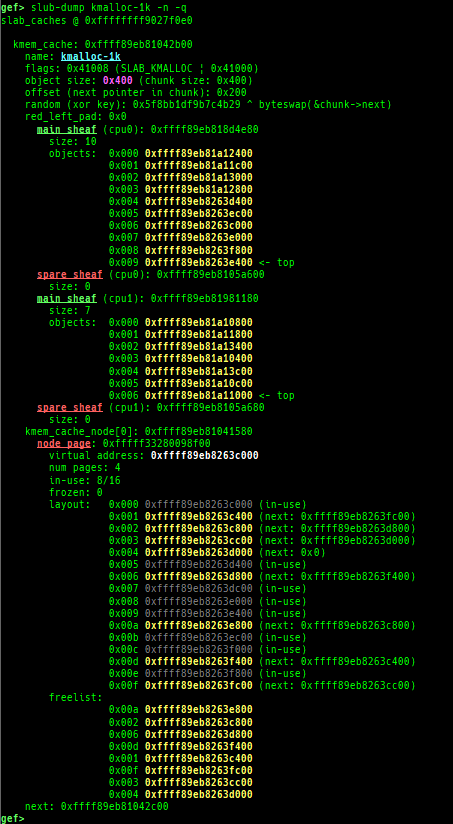
- `slab-dump`: dumps slab free-list.
    - Supported on x64/x86/ARM64/ARM + `SLAB` + no-symbol + kASLR.
    - 
- `slob-dump`: dumps slob free-list.
    - Supported on x64/x86/ARM64/ARM + `SLOB` + no-symbol + kASLR.
    - 
- `slub-tiny-dump`: dumps slub-tiny free-list.
    - Supported on x64/x86/ARM64/ARM + `SLUB-TINY` + no-symbol + kASLR.
    - 
- `slab-contains`: resolves the slab cache (`kmem_cache`) that a certain address (object) belongs to (for `SLUB`/`SLUB-TINY`/`SLAB`).
    - 
    - For `SLUB`/`SLUB-TINY`, if all chunks belonging to a certain `page` are in use, they will not be displayed by `slub-dump`/`slub-tiny-dump` command.
    - Even with such an address (object), this command may be able to resolve `kmem_cache`.
- `kmem-cache-alias`: dumps `kmem_cache` alias name.
    - 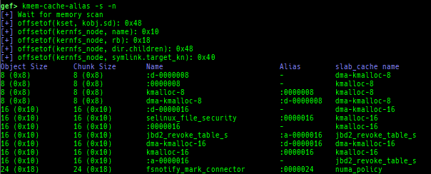
- `buddy-dump`: dumps the zone of the page allocator (buddy allocator) free-list.
    - 
- `buddy-contains`: resolves which buddy allocator block contains it.
    - 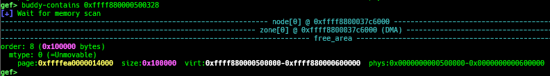
- `vmalloc-dump`: dumps `vmalloc` used-list and freed-list.
    - 
- `kobj`: identifies an arbitrary kernel address.
    - 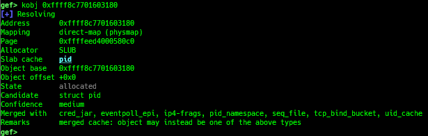

</details>

#### Linux Dynamic Inspection

<details>
<summary><code>ktrace</code>, <code>thunk-tracer</code>, <code>usermodehelper-tracer</code>, <code>kmalloc-tracer</code>, <code>kmalloc-allocated-by</code>, <code>kuaf-watch</code>, <code>kpage-watch</code></summary>

- `ktrace`: traces arguments and returns of the specified kernel functions.
    - 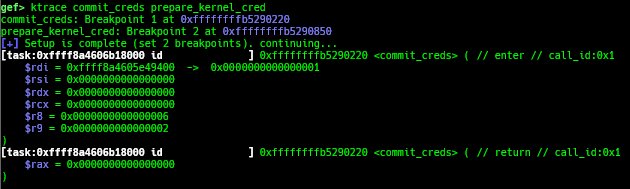
- `thunk-tracer`: collects and displays the thunk function addresses that are called automatically (x64/x86 only).
    - If this address comes from RW area, this is useful for getting RIP.
    - 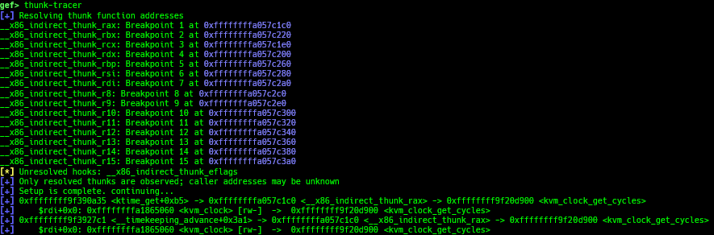
- `usermodehelper-tracer`: collects and displays the information that is executed by `call_usermodehelper_setup`.
    - 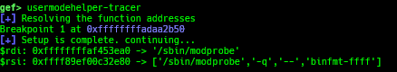
- `kmalloc-tracer`: collects and displays information when `kmalloc`/`kfree`.
    - 
- `kmalloc-allocated-by`: calls a predefined set of system calls and prints structures allocated by `kmalloc` or freed by `kfree`.
    - 
- `kuaf-watch`: tracks the alloc/free/reuse lifecycle of a slab object (or an entire cache) for UAF analysis.
    - 
- `kpage-watch`: tracks the alloc/free/slab lifecycle of a physical page (PFN) for cross-cache analysis.
    - 

</details>

#### TrustZone

<details>
<summary><code>xsm</code>, <code>wsm</code>, <code>bsm</code>, <code>optee-break-ta</code>, <code>optee-smc-service-dump</code>, <code>optee-ta-dump</code>, <code>optee-shm-list</code>, <code>optee-bget-dump</code></summary>

- `xsm`: dumps secure memory when gdb is in normal world.
    - Supported on ARM64 and ARM.
    - 
- `wsm`: writes the value to secure memory when gdb is in normal world.
    - Supported on ARM64 and ARM.
    - 
- `bsm`: sets the breakpoint to secure memory when gdb is in normal world.
    - Supported on ARM64 and ARM.
    - 
- `optee-break-ta`: sets the breakpoint to the offset of OPTEE-Trusted-App when gdb is in normal world.
    - Supported on ARM64 and ARM.
    - 
- `optee-smc-service-dump`: dumps OPTEE SMC services.
    - Supported on ARM64.
    - 
- `optee-ta-dump`: dumps the information of OPTEE-Trusted-Apps from the memory or specified host directory.
    - Supported on ARM64 and ARM.
    - 
- `optee-shm-list`: shows the information of dynamic shared-memory buffers.
    - Supported on ARM64 and ARM.
    - 
- `optee-bget-dump`: dumps bget allocator of OPTEE-Trusted-App.
    - 

</details>

#### Other

<details>
<summary><code>ksearch-code-ptr</code>, <code>kdiff</code>, <code>uefi-ovmf-info</code>, <code>qemu-device-info</code></summary>

- `ksearch-code-ptr`: searches for the code pointer in kernel data area.
    - 
- `kdiff`: compares kernel information (function pointers, etc.) at two points in time.
    - 
- `uefi-ovmf-info`: dumps addresses of some important structures in each boot phase of UEFI when OVMF is used.
    - Supported on x64.
    - 
- `qemu-device-info`: dumps device information for qemu-escape.
    - 

</details>

#### SMM

<details>
<summary><code>smm-status</code>, <code>smm-dump</code></summary>

- `smm-status`: displays the current SMM status and an SMRAM preview.
    - 
- `smm-dump`: dumps the detected SMRAM range to a file.
    - 

</details>

### Heap Dump Features

#### Glibc

<details>
<summary><code>heap arenas</code>, <code>heap top</code>, <code>heap bins-simple</code>, <code>heap parse</code>, <code>heap try-malloc</code>, <code>heap try-free</code>, <code>heap try-realloc</code>, <code>heap try-calloc</code>, <code>heap tcache-index-helper</code>, <code>heap find-fake-fast</code>, <code>heap extract-heap-addr</code>, <code>heap calc-protected-fd</code>, <code>heap visual-heap</code>, <code>heap tracer</code>, <code>heap dump-image</code>, <code>heap snapshot</code>, <code>heap snapshot-compare</code></summary>

- Glibc heap commands have been improved. Supports up to glibc 2.43.
    - It changes the color and prints a symbol if it exists.
        - 
    - They print bins information if the chunk is in free-list.
        - 
    - Thread arena is supported for all `heap` commands.
        - Use `-a` option.
    - It supports some new sub-commands.
        - `heap arenas`
            - 
        - `heap top`
            - 
        - `heap bins-simple`: displays the heap like pwndbg style.
            - 
        - `heap parse`: displays the heap like as Pwngdb/angelheap style.
            - 
        - `heap try-malloc`
            - 
        - `heap try-free`
            - 
            - You can also execute any command on the memory status after emulation is completed.
                - 
        - `heap try-realloc`
        - `heap try-calloc`
        - `heap tcache-index-helper`
            - 
        - `heap find-fake-fast`: searches for a memory with a size-like value that can be linked to the fastbin free-list.
            - 
        - `heap extract-heap-addr`: analyzes tcache-protected-fd introduced from glibc-2.32.
            - 
        - `heap calc-protected-fd`: calculates a valid value as protected fd.
            - 
        - `heap visual-heap`: is colorized heap viewer.
            - 
        - `heap tracer`: has been integrated from `heap-analysis-helper` and rewritten.
            - 
        - `heap dump-image`: visualizes chunks on a heap as composition image.
            - 
        - `heap snapshot`: takes a snapshot of the heap.
        - `heap snapshot-compare`: compares current heap with a previously saved heap-snapshot.
            - 

</details>

#### Chromium/V8

<details>
<summary><code>partition-alloc-dump</code>, <code>v8</code>, <code>cage</code>, <code>v8-list-maps</code>, <code>v8-dump-space</code></summary>

- `partition-alloc-dump`: dumps Partition-Alloc free-list for chromium.
    - 
    - This command is reserved for the implementation of the latest version of Chromium.
        - Currently tested: v150.x / [1632226](https://commondatastorage.googleapis.com/chromium-browser-snapshots/index.html?prefix=Linux_x64/1632226/) / 59f0b217abe111a4da9ba967f3586c048f6d4c47
    - Supported on x64 and ARM64 (maybe it works on x86/ARM too, but not tested).
    - It will try heuristic search if the binary has no symbol.
    - How to test:
        - See [dev/partition-alloc-dump/downloader.py](dev/partition-alloc-dump/downloader.py).
- `v8`: displays v8 (Chromium and `d8`) tagged object.
    - 
    - It also loads more commands from latest gdbinit for v8.
    - 
- `cage`: displays v8 (Chromium and `d8`) ubercage.
    - 
- `v8-list-maps`: lists v8 (Chromium and `d8`) built-in maps.
    - 
- `v8-dump-space`: dumps v8 (Chromium and `d8`) heap objects in each space.
    - 

</details>

#### Other

<details>
<summary><code>uclibc-ng-heap-dump</code>, <code>uclibc-ng-visual-heap</code>, <code>tcmalloc-heap-dump</code>, <code>musl-heap-dump</code>, <code>go-heap-dump</code>, <code>tlsf-heap-dump</code>, <code>hoard-heap-dump</code>, <code>mimalloc-heap-dump</code>, <code>scalloc-heap-dump</code>, <code>snmalloc-heap-dump</code>, <code>ssmalloc-heap-dump</code>, <code>jemalloc-heap-dump</code>, <code>sfmalloc-heap-dump</code>, <code>rpmalloc-heap-dump</code>, <code>tbbmalloc-heap-dump</code></summary>

- `uclibc-ng-heap-dump`: dumps uClibc-ng heap chunks.
    - Supported on x64 and x86, based on uClibc-ng malloc-standard.
    - 
    - How to test (x64):
        - Download and extract `x86-64--uclibc--stable-2025.08-1.tar.bz2` from https://toolchains.bootlin.com/
        - Add `/PATH/TO/x86_64-buildroot-linux-uclibc/bin` to `$PATH`, then build as `x86_64-linux-gcc test.c`.
        - Fix interpreter by `patchelf --set-interpreter /PATH/TO/x86_64-buildroot-linux-uclibc/sysroot/lib/ld64-uClibc.so.0 a.out`.
- `uclibc-ng-visual-heap`: is colorized heap viewer for uClibc-ng.
    - 
- `tcmalloc-heap-dump`: dumps TCMalloc (`gperftools-2.16-1` or named `libgoogle-perftools{4,-dev}`) free-list (x64 only).
    - 
    - How to test:
        - Run your test program with `LD_PRELOAD=/usr/lib/x86_64-linux-gnu/libtcmalloc.so ./a.out`.
- `musl-heap-dump`: dumps Musl-Libc v1.2.5 heap chunks (x64/x86 only).
    - 
    - How to test:
        - Get and extract the upstream source from https://musl.libc.org/
        - Build with `./configure && make install`.
        - Then build with `/usr/local/musl/bin/musl-gcc test.c`.
- `go-heap-dump`: dumps Go Language v1.24.4 mheap (x64 only).
    - 
- `tlsf-heap-dump`: dumps TLSF (Two-Level Segregated Fit) v2.4.6 free-list (x64 only).
    - 
    - How to test (x64):
        - Get and extract the upstream source from http://www.gii.upv.es/tlsf/
        - Build with `cd TLSF-2.4.6/src && make && cd ../examples && make` then use `test1` etc.
- `hoard-heap-dump`: dumps Hoard v3.2 (2025/12/31) free-list (x64 only).
    - 
    - How to test (x64):
        - Get and extract the upstream source from https://github.com/emeryberger/Hoard
        - Build with `cd Hoard/src && make`.
        - Run your test program with `LD_PRELOAD=/PATH/TO/libhoard.so ./a.out`.
- `mimalloc-heap-dump`: dumps mimalloc free-list (x64 only).
    - 
    - How to test (x64):
        - Get and extract the upstream source from https://github.com/microsoft/mimalloc
        - Build with `mkdir build && cd build && cmake -DCMAKE_BUILD_TYPE=Debug .. && make`.
        - Run your test program with `LD_PRELOAD=/PATH/TO/libmimalloc.so ./a.out`.
- `scalloc-heap-dump`: dumps scalloc free-list (x64 only).
    - 
    - How to test (x64):
        - Get and extract the upstream source from https://github.com/cksystemsgroup/scalloc
        - Fix the bug with `sed -i -e 's/\(strncat(.*\), 1);/\1, 2);/' src/log.h`.
        - Build with `gyp --depth . scalloc.gyp && make`.
        - Enable overcommit with `echo 1 > /proc/sys/vm/overcommit_memory`.
        - Run your test program with `LD_PRELOAD=/PATH/TO/libscalloc.so ./a.out`.
- `snmalloc-heap-dump`: dumps snmalloc free-list (x64 only).
    - 
    - How to test (x64):
        - Get and extract the upstream source from https://github.com/microsoft/snmalloc
        - Build with `mkdir build && cd build && cmake -G Ninja .. -DCMAKE_BUILD_TYPE=Debug && ninja`.
        - Run your test program with `LD_PRELOAD=/PATH/TO/libsnmallocshim.so ./a.out`.
- `ssmalloc-heap-dump`: dumps ssmalloc free-list (x64 only).
    - 
    - How to test (x64):
        - Get and extract the upstream source from https://github.com/Naruil/SSMalloc
        - Patch `new_delete.cpp` because the original source uses dynamic exception specifications, which are rejected by C++17 and later:
            - `sed -i -e 's/ throw *(std::bad_alloc)//g' -e 's/^void operator delete(void \*ptr)$/void operator delete(void *ptr) noexcept/' -e 's/^void operator delete\[\](void \*ptr)$/void operator delete[](void *ptr) noexcept/' new_delete.cpp`
        - Build with `make`
        - Run your test program with `LD_PRELOAD=/PATH/TO/libssmalloc.so ./a.out`.
- `jemalloc-heap-dump`: dumps jemalloc v3.0~ arenas, slabs and tcache (x64 only).
    - 
    - How to test (x64):
        - Install `libjemalloc2` (e.g. `apt install libjemalloc2`), or get and extract the upstream source from https://github.com/jemalloc/jemalloc/releases
        - Build with `./configure && make build_lib_shared`.
        - Run your test program with `LD_PRELOAD=/usr/lib/x86_64-linux-gnu/libjemalloc.so.2 ./a.out` (or `/PATH/TO/lib/libjemalloc.so.2`).
- `sfmalloc-heap-dump`: dumps sfmalloc free-list (x64 only).
    - 
    - How to test (x64):
        - Get and extract the upstream source from https://github.com/jeffhammond/sfmalloc
        - Build with `cd sfmalloc && make CXX='g++ -std=gnu++03' DEFS='-D_REENTRANT -include stddef.h'`.
        - Run your test program with `LD_PRELOAD=/PATH/TO/libsfmalloc.so ./a.out`.
- `rpmalloc-heap-dump`: dumps rpmalloc free-list.
    - 
    - How to test (x64):
        - Get and extract the upstream source from https://github.com/mjansson/rpmalloc
        - Build with `cd rpmalloc && git switch main && python3 configure.py && ninja`.
        - Run your test program with `LD_PRELOAD=/PATH/TO/bin/linux/release/librpmalloc.so ./a.out`.
- `tbbmalloc-heap-dump`: dumps tbbmalloc free-list.
    - 
    - How to test (x64):
        - Get and extract the upstream source from https://github.com/uxlfoundation/oneTBB
        - Build with `mkdir build && cd build && cmake .. && make`.
        - Run your test program with `LD_PRELOAD=/PATH/TO/libtbbmalloc_proxy.so ./a.out`.

</details>

### Qemu-user Cooperation

For the supported architectures, see [docs/QEMU-USER-SUPPORTED-ARCH.md](docs/QEMU-USER-SUPPORTED-ARCH.md).

<details>
<summary><code>si</code>, <code>ni</code>, <code>c</code></summary>

- `si`/`ni`: are wrappers for native `si`/`ni` if OpenRISC 1000 or CRIS.
    - On OpenRISC 1000 architecture, branch operations don't work well, so GEF uses breakpoints to simulate.
    - On CRIS architecture, `stepi`/`nexti` commands don't work well, so GEF uses breakpoints to simulate.
    - If you want to use native `si`/`ni`, use the full form `stepi`/`nexti`.
- `c`: is the wrapper for native `c` if gdb is connected to `qemu-user` or `Intel Pin`.
    - When connecting to gdb stub of `qemu-user` or `Intel Pin`, gdb does not trap `SIGINT` during `continue`.
    - If you want to trap, you need to issue `SIGTRAP` on the `qemu-user` or `pin` side, but switching screens is annoying.
    - This command realizes a pseudo `SIGTRAP` trap by trapping `SIGINT` on the Python side and throwing `SIGTRAP` back to `qemu-user` or `Intel Pin`.
    - It works only for local `qemu-user` or `Intel Pin`.
    - If you want to use native `c`, use the full form `continue`.

</details>

### Debugging Support

#### Context

<details>
<summary><code>context</code>, <code>registers</code>, <code>telescope</code></summary>

- `context` *(improved)*
    - It supports automatic display of system call arguments when calling a system call.
        - 
    - It supports new commands: `context on`, `context off`.
    - It supports automatic display of address and value when accessing memory.
        - 
    - It supports smart symbol printing for C++ function.
        - ex: `std::map<int, std::map<int, int>>` will be replaced by `std::map<...>`.
        - 
        - command: `gef config context.smart_cpp_function_name true` or `smart-cpp-function-name` (latter is used to toggle).
- `registers` *(improved)*
    - It also shows raw values of the flag register, the current ring, the exception level, the secure state, etc.
        - 
        - 
        - 
- `telescope` *(improved)*
    - It displays ordinal numbers as well as offsets.
    - It displays if there are canaries and return addresses in the target area.
        - 
    - It supports blacklist address features (to avoid dying when touching the address mapped to the serial device).
    - It also shows the symbol if available.
    - It supports some new options: `--is-addr`, `--is-not-addr`, `--perm`, `--is-zero`, `--is-not-zero`, `--mask-hits`, `--no-mask-hits`, `--tag`, `--frame-split`, `--uniq`, `--interval`, `--depth`, `--phys`, `--list-head`, `--slab-contains`, `--slab-contains-unaligned`.

</details>

#### Breakpoint

<details>
<summary><code>break-rva</code>, <code>command-break</code>, <code>main-break</code>, <code>load-break</code>, <code>regdump-break</code>, <code>multi-break</code>, <code>break-if-taken</code>, <code>break-if-not-taken</code></summary>

- `break-rva`: sets a breakpoint at relative offset from codebase.
    - 
- `command-break`: sets a breakpoint which executes user defined command if hit.
    - 
- `main-break`: sets a breakpoint at `main` with or without symbols, then continue.
    - This is useful when you just want to run to `main` using `qemu-user` or `pin`, or debugging no-symbol ELF.
- `load-break`: breaks if something is loaded.
- `regdump-break`: sets a breakpoint which dumps specified registers if hit.
- `multi-break`: sets multiple breakpoints easily.
- `break-if-taken`/`break-if-not-taken`: sets a breakpoint which breaks if branch is taken (or not taken).

</details>

#### Basic Command Extension

<details>
<summary><code>up</code>, <code>down</code>, <code>time</code>, <code>multi-line</code>, <code>stepi-for-kgdb</code></summary>

- `up`/`down`: are wrappers for native `up`/`down`.
    - It shows also backtrace.
- `time`: measures the time of the GDB command.
    - 
- `multi-line`: executes multiple GDB commands in sequence.
    - 
- `stepi-for-kgdb`: is wrapper for AArch64 KGDB that avoids stepping into pending IRQ handlers.

</details>

#### Execution

<details>
<summary><code>exec-until</code>, <code>call-trace</code>, <code>xuntil</code>, <code>strings-continue</code>, <code>xskip</code></summary>

- `exec-until`: executes until specified operation.
    - Supports the following patterns: call, jmp, syscall, ret, indirect-branch (x64/x86 only), all-branch (call || jmp || ret), memory-access, specified-keyword-regex, specified-condition (expressions using register or memory values), user-code, libc-code, secure-world, region-change.
    - 
- `call-trace`: traces call, ret, and syscall instructions.
    - 
- `xuntil`: executes until specified address.
    - It is slightly easier to use than the original until command.
- `strings-continue`: single-steps and prints ASCII strings referenced by general-purpose registers.
- `xskip`: skips instructions easily.

</details>

#### Assemble

<details>
<summary><code>ii</code>, <code>dasm</code>, <code>asm-list</code></summary>

- `ii`: is a shortcut for `x/50i $pc` with opcode bytes.
    - It prints the value if it is memory access operation.
    - 
- `dasm`: disassembles the code by capstone.
    - 
- `asm-list`: lists instructions. (x64/x86 only)
    - 
    - This command uses x86data.js from https://github.com/asmjit/asmdb

</details>

#### Context Extension

<details>
<summary><code>extra</code>, <code>comment</code>, <code>smart-cpp-function-name</code></summary>

- `extra`: manages user specified command to execute when each step.
- `comment`: manages user specified temporary comment.
- `smart-cpp-function-name`: toggles `context.smart_cpp_function_name` setting.

</details>

#### Syscall

<details>
<summary><code>mprotect</code>, <code>hijack-fd</code>, <code>call-syscall</code>, <code>mmap</code>, <code>munmap</code>, <code>kill-threads</code>, <code>syscall-search</code>, <code>xtap</code></summary>

- `mprotect` *(improved)*
    - Rewritten to use `call-syscall`.
- `hijack-fd` *(improved)*
    - It supports more architectures.
    - 
- `call-syscall`: calls system call with specified values.
    - 
- `mmap`: allocates a new memory by `call-syscall`.
- `munmap`: unmaps a memory by `call-syscall`.
- `kill-threads`: kills specific or all threads (for `pthread`).
- `syscall-search`: searches for system call by regex.
    - 
- `xtap`: taps read/write syscalls on specific file descriptors and hexdumps the transferred data.

</details>

#### Emulation

<details>
<summary><code>unicorn-emulate</code>, <code>unicorn-emulate-script</code>, <code>angr</code>, <code>future-calls</code></summary>

- `unicorn-emulate` *(improved)*
    - It reads and writes correctly to the address pointed to by `$fs`/`$gs`.
    - It supports a new mode to stop after executing N instructions (`-g`).
    - It shows changed memories.
        - 
    - It supports replacing the GOT of string functions using avx2 or NEON, which unicorn does not support, with slower original functions.
- `unicorn-emulate-script`: generates and runs a standalone script that emulates the binary by Unicorn-Engine.
- `angr`: finds simple constraints by `angr`.
    - 
- `future-calls`: displays future function calls from the current function.
    - 

</details>

#### Other

<details>
<summary><code>ropper</code>, <code>format-string-helper</code>, <code>add-symbol-temporary</code>, <code>seccomp</code>, <code>onegadget</code>, <code>rp</code>, <code>follow</code></summary>

- `ropper` *(improved)*
    - It does not reset autocomplete settings after calling imported `ropper`.
- `format-string-helper` *(improved)*
    - It supports more `printf`-like functions.
- `add-symbol-temporary`: adds symbol information from command-line.
    - 
- `seccomp`: invokes `ceccomp` or `seccomp-tools`.
- `onegadget`: invokes `one_gadget`.
    - 
- `rp`: invokes `rp++` with commonly used options.
- `follow`: changes `follow-fork-mode` setting.
    - 

</details>

### Process Information

#### General

<details>
<summary><code>proc-info</code>, <code>elf-info</code>, <code>fds</code>, <code>proc-dump</code></summary>

- `proc-info` *(improved)*
    - It displays some additional information.
        - 
- `elf-info` *(improved)*
    - It displays Program Header and Section Header.
    - It supports parsing from memory.
    - It supports parsing remote binary (if download feature is available).
        - 
- `fds`: shows opened file descriptors.
- `proc-dump`: dumps each file under `/proc/PID/`.
    - 

</details>

#### Base Address

<details>
<summary><code>tls</code>, <code>fsbase</code>, <code>gsbase</code>, <code>libc</code>, <code>ld</code>, <code>heapbase</code>, <code>codebase</code></summary>

- `tls`: pretty prints TLS area. Requires glibc.
    - 
- `fsbase`/`gsbase`: pretty prints `$fs_base`, `$gs_base`.
    - 
- `libc`/`ld`/`heapbase`/`codebase`: displays each of the base address.
    - 

</details>

#### Memory/Section

<details>
<summary><code>vmmap</code>, <code>xinfo</code></summary>

- `vmmap` *(improved)*
    - It displays the memory map information even when connecting to gdb stub of `qemu-user`.
        - 
    - It also supports `Intel Pin`.
        - 
    - It also supports `Intel SDE`.
        - 
    - It is redirected to `kvmmap` when connecting to gdb stub of `qemu-system`.
    - It supports detection and coloring of `Writable`, `ReadOnly`, `None` and `RWX` regions.
    - It shows the area each register points to.
- `xinfo` *(improved)*
    - It shows more information.
        - 
    - It also supports kernel debugging.

</details>

#### Trivial Information

<details>
<summary><code>pid</code>, <code>tid</code>, <code>filename</code>, <code>auxv</code>, <code>argv</code>, <code>envp</code>, <code>dumpargs</code>, <code>vdso</code>, <code>vvar</code>, <code>errno</code></summary>

- `pid`/`tid`: prints pid and tid.
- `filename`: prints filename.
- `auxv`: pretty prints ELF auxiliary vector.
    - Supported also under `qemu-user`.
    - 
- `argv`/`envp`: pretty prints argv and envp.
    - 
- `dumpargs`: dumps arguments of current function.
    - 
- `vdso`: disassembles the text area of vdso smartly.
    - 
- `vvar`: dumps the area of vvar.
    - This area is mapped to userland, but cannot be accessed from gdb.
    - Therefore, it executes the assembly code and retrieves the contents.
    - 
- `errno`: displays errno list or specified errno.
    - 

</details>

#### Complex Structure Information

<details>
<summary><code>got</code>, <code>got-all</code>, <code>dwarf-exception-handler</code>, <code>dynamic</code>, <code>link-map</code>, <code>dtor-dump</code>, <code>iouring-dump</code>, <code>stdio-dump</code>, <code>fpchain</code>, <code>unwind-info</code>, <code>cpp-vtable</code></summary>

- `got` *(improved)*
    - It displays not only GOT address but also PLT address.
        - 
    - It scans `.plt.sec` section if Intel CET is enabled.
    - It can also display the GOT of the library.
        - 
    - It can also display `type`, `offset`, `reloc_arg`, `section` and `permission`.
        - 
- `got-all`: shows got entries for all libraries.
- `dwarf-exception-handler`: dumps the DWARF exception handler information.
    - 
- `dynamic`: dumps the `_DYNAMIC` area.
    - 
- `link-map`: dumps useful members of `link_map` with iterating.
    - 
- `dtor-dump`: dumps some destructor functions list.
    - 
- `iouring-dump`: dumps the area of iouring (x64 only).
    - This area is mapped to userland, but cannot be accessed from gdb.
    - Therefore, it executes the assembly code and retrieves the contents.
    - 
- `stdio-dump`: dumps members of stdin/stdout/stderr.
    - 
- `fpchain`: dumps chains from `__IO_list_all`.
    - 
- `unwind-info`: shows the effective DWARF unwind rules at the current or specified PC.
    - 
- `cpp-vtable`: dumps C++ virtual tables and RTTI from an object or base subobject.
    - 

</details>

#### Security

<details>
<summary><code>checksec</code>, <code>canary</code>, <code>capability</code>, <code>ptr-mangle</code>, <code>ptr-demangle</code>, <code>search-mangled-ptr</code>, <code>mte-tags</code>, <code>sighands</code></summary>

- `checksec` *(improved)*
    - It shows additional information.
        - Static or Dynamic or Static-PIE
        - Stripped or not
        - Debuginfo or not
        - Intel CET IBT/SHSTK
        - ARMv8 PAC, ARMv8 MTE
        - RPATH, RUNPATH
        - Clang CFI/SafeStack
        - System-ASLR, GDB ASLR setting
    - It supports parsing remote binary (if download feature is available).
    - 
- `canary` *(improved)*
    - It displays all canary positions in memory.
        - 
- `capability`: shows the capabilities of the debugging process.
    - 
- `ptr-mangle`: shows the mangled value that will be mangled by `PTR_MANGLE`.
- `ptr-demangle`: shows the demangled value of the value mangled by `PTR_MANGLE`.
    - 
- `search-mangled-ptr`: searches for the mangled value from RW memory.
    - 
- `mte-tags`: displays the MTE tags for the specified address.
    - Supported on ARM64.
    - 
- `sighands`: displays the signal dispositions of the current process.
    - 

</details>

#### Symbol

<details>
<summary><code>magic</code>, <code>symbols</code></summary>

- `magic`: displays useful addresses in glibc etc.
    - 
- `symbols`: lists all symbols with coloring.
    - 

</details>

#### Type

<details>
<summary><code>types</code>, <code>dt</code></summary>

- `types`: lists all types with compaction.
    - 
- `dt`: makes it easier to use `ptype /ox TYPE` and `p ((TYPE*) ADDRESS)[0]`.
    - 
    - This command is designed for several purposes.
        1. When displaying very large struct, you may want to go through a pager because the results will not fit on one screen.
           However, using a pager, the color information disappears. This command calls the pager with preserving colors.
        2. When `ptype /ox TYPE`, interpreting member type recursively often result is too long and difficult to read.
           This command keeps result compact by displaying only top-level members.
        3. When `p ((TYPE*) ADDRESS)[0]` for large struct, the setting of `max-value-size` is too small to display.
           This command adjusts it automatically.
        4. When debugging a binary written in the Golang, the offset information of the type is not displayed.
           This command also displays the offset.
        5. When debugging a binary written in the Golang, the `p ((TYPE*) ADDRESS)[0]` command will be broken.
           This is because the Golang helper script is automatically loaded and overwrites the behavior of `p` command.
           This command creates the display results on the Python side, so we can display it without any problems.

</details>

### Memory

#### Search

<details>
<summary><code>search-pattern</code>, <code>strings</code>, <code>search-cfi-gadgets</code>, <code>find-syscall</code></summary>

- `search-pattern` *(improved)*
    - It is supported under qemu-system (in short, it works without `/proc/self/maps`)
    - It supports some new options: `--hex`, `--hex-regex`, `--aligned`, `--perm`, `--interval`, `--limit`, `--max-region-size`, `--phys`.
    - It also searches for UTF-16 string if target string is ASCII.
    - 
- `strings`: searches for ASCII string from specific location.
    - 
- `search-cfi-gadgets`: searches for CFI-valid (for CET IBT) and controllable generally gadgets in the executable area.
    - 
- `find-syscall`: searches the syscall gadget.
    - 

</details>

#### View

<details>
<summary><code>hexdump</code>, <code>hexdump-flexible</code>, <code>json</code>, <code>xs</code>, <code>xc</code>, <code>sigreturn</code>, <code>ucontext</code>, <code>jmpbuf</code></summary>

- `hexdump` *(improved)*
    - It supports physical memory if under qemu-system.
    - It will retry with adjusting read size if reading memory fails.
    - By default, the same line is omitted.
    - 
- `hexdump-flexible`: displays the hexdump with user defined format.
    - 
- `json`: pretty prints json.
    - 
- `xs`: dumps string like `x/s` command, but with hex-string style.
    - 
- `xc`: dumps address like `x/x` command, but with coloring at some intervals.
    - 
- `sigreturn`: displays stack values for sigreturn syscall.
    - 
- `ucontext`: displays the register state saved in a `ucontext_t` or `mcontext_t`.
    - 
- `jmpbuf`: displays the registers saved in a `jmp_buf` or `sigjmp_buf` of glibc, with `PTR_MANGLE` decoded.
    - 

</details>

#### Compare

<details>
<summary><code>memcmp</code></summary>

- `memcmp`: compares the contents of the address A and B, whether virtual or physical.
    - 

</details>

#### Patch

<details>
<summary><code>patch</code>, <code>memset</code>, <code>memcpy</code>, <code>memswap</code>, <code>meminsert</code></summary>

- `patch` *(improved)*
    - It supports physical memory if under qemu-system.
    - Added some new modes: `patch hex`, `patch pattern`, `patch nop`, `patch inf`, `patch trap`, `patch ret`, `patch syscall`, `patch history`, `patch revert`, `patch range-replace`, `patch undo`, `patch redo`.
    - `nop` command has been integrated into `patch` as sub-command.
    - 
- `memset`: sets the value to the memory range, whether virtual or physical.
- `memcpy`: copies the contents from the address A to B, whether virtual or physical.
- `memswap`: swaps the contents of the address A and B, whether virtual or physical.
- `meminsert`: inserts the contents of the address A to B, whether virtual or physical.
    - 

</details>

#### Calculation

<details>
<summary><code>hash</code>, <code>crc</code>, <code>base-n-decode</code>, <code>base-n-encode</code>, <code>morse-decode</code>, <code>morse-encode</code>, <code>strlen</code>, <code>is-mem-zero</code>, <code>seq-length</code></summary>

- `hash`: calculates various (450+) hashes, or show known-collisions.
    - 
- `crc`: calculates various CRCs.
    - 
- `base-n-decode`/`base-n-encode`: decodes/encodes various baseN.
    - 
- `morse-decode`/`morse-encode`: decodes/encodes morse code.
    - 
- `strlen`: detects the length of the string.
    - 
- `is-mem-zero`: checks the contents of address range are all 0x00 or 0xff.
    - 
- `seq-length`: detects consecutive length of the same sequence.
    - 

</details>

#### Dump/Load

<details>
<summary><code>smart-memory-dump</code>, <code>load-file</code>, <code>load-file-mmap</code></summary>

- `smart-memory-dump`: dumps all regions of the memory to each file.
    - 
- `load-file`: loads the file into memory.
- `load-file-mmap`: loads the file into memory that allocated by `mmap`.

</details>

#### Investigation

<details>
<summary><code>binwalk-memory</code>, <code>filetype-memory</code>, <code>sixel-memory</code>, <code>peek-pageframe</code>, <code>peek-pageflags</code>, <code>vdump</code>, <code>freq-analysis</code>, <code>stack-recover</code></summary>

- `binwalk-memory`: scans memory by `binwalk`.
    - 
- `filetype-memory`: scans memory by `file` and `magika`.
    - 
- `sixel-memory`: shows image to terminal by `imagemagick`.
    - 
    - If you have `pillow` and `pyzbar` installed, a barcode detection option is also available.
- `peek-pageframe`: reads page frame data.
    - 
- `peek-pageflags`: reads page flags of a page frame.
    - 
- `vdump`: visualizes memory data like an image.
    - 
- `freq-analysis`: visualizes the frequency of occurrence of each byte.
    - 
- `stack-recover`: heuristically recovers the call chain from the stack when `bt` is unusable.
    - 

</details>

### Register

#### View

<details>
<summary><code>sysreg</code>, <code>pac-keys</code>, <code>fpu</code>, <code>mmx</code>, <code>sse</code>, <code>avx</code>, <code>avx512</code>, <code>cpuid</code></summary>

- `sysreg`: pretty prints system registers.
    - It shows `info registers` results, excluding general registers.
    - 
- `pac-keys`: pretty prints ARM64 PAC keys.
    - Supported on ARM64.
    - 
- `fpu`/`mmx`/`sse`/`avx`/`avx512`: pretty prints FPU/MMX/SSE/AVX/AVX512 registers.
    - 
- `cpuid`: shows the result of cpuid(eax=0,1,2...).
    - 

</details>

#### Modify

<details>
<summary><code>edit-flags</code>, <code>xmmset</code>, <code>mmxset</code></summary>

- `edit-flags` *(improved)*
    - It displays the meaning of each bit if `-v` option is provided.
        - 
        - 
        - 
- `xmmset`: sets the value to xmm/ymm/zmm register simply.
    - 
- `mmxset`: sets the value to mm register simply.
    - 

</details>

### Misc

#### Conversion

<details>
<summary><code>u2d</code>, <code>unsigned</code>, <code>convert</code>, <code>addressify</code>, <code>cpp-mangle</code>, <code>cpp-demangle</code></summary>

- `u2d`: shows cast/convert u64 <-> double/float.
    - 
- `unsigned`: shows unsigned value.
    - 
- `convert`: shows various conversion.
    - 
- `addressify`: converts reverse-order hex values to address.
    - 
- `cpp-mangle`/`cpp-demangle`: mangles/demangles a C++ name by the Itanium C++ ABI.

</details>

#### Search

<details>
<summary><code>constgrep</code></summary>

- `constgrep`: invokes `grep` under `/usr/include/`.
    - 

</details>

#### Show Example

<details>
<summary><code>ret2dl-hint</code>, <code>srop-hint</code></summary>

- `ret2dl-hint`: shows the structure used by return-to-dl-resolve as hint.
    - 
- `srop-hint`: shows the code for sigreturn-oriented-programming as hint.
    - 

</details>

#### Calculation

<details>
<summary><code>distance</code>, <code>crc32rev</code></summary>

- `distance`: calculates the offset from its base address.
    - 
- `crc32rev`: performs CRC32 reverse calculation limited to ASCII character range.
    - 

</details>

#### Diff

<details>
<summary><code>saveo</code>, <code>diffo</code></summary>

- `saveo`/`diffo`: saves and diffs the command outputs.
    - 

</details>

#### Qemu-system

<details>
<summary><code>qemu-system-memory-region-dump</code></summary>

- `qemu-system-memory-region-dump`: dumps memory regions for `qemu-system`.
    - 

</details>

### GEF Maintenance

<details>
<summary><code>theme</code>, <code>reset-cache</code>, <code>tmux-setup</code>, <code>gef version</code>, <code>gef status</code>, <code>gef reset-breakpoint</code>, <code>gef arch-list</code>, <code>gef pyobj-list</code>, <code>gef avail-comm-list</code>, <code>gef set-arch</code>, <code>gef check-update</code>, <code>gef dump-commands</code>, <code>history</code></summary>

- `theme` *(improved)*
    - Supports many colors.
    - 
    - 
- `reset-cache` *(improved)*
    - It has been integrated into `gef` as sub-command.
    - The cache structure within GEF has changed significantly. This command corresponds to them.
- `tmux-setup` *(improved)*
    - It has been integrated into `gef` as sub-command.
    - `screen` is no longer supported.
    - `tmux` settings are predefined and cannot be customized.
    - If you want to customize it, edit [dev/tmux/tmux_setup.py](dev/tmux/tmux_setup.py) and run `source /path/to/tmux_setup.py`.
    - If you're a `zellij` user, you can use [dev/zellij/zellij-wrapper.py](dev/zellij/zellij-wrapper.py). Run this script before starting `gdb` or `zellij`.
- `gef version`: shows software versions that GEF uses.
    - 
- `gef status`: shows architecture information used in GEF.
    - 
- `gef reset-breakpoint`: shows and resets all breakpoints.
- `gef arch-list`: displays defined architecture information.
    - 
- `gef pyobj-list`: displays defined global Python objects.
    - 
- `gef avail-comm-list`: displays a list of commands which are available or not for the current architecture and gdb execution mode.
    - 
- `gef set-arch`: sets a specific architecture to GEF.
- `gef check-update`: checks for GEF updates.
- `gef dump-commands`: dumps GEF command documentation as Markdown.
- `history`: shows gdb command history easily.
    - 

</details>

### Other
- The category is introduced in `gef help`.
    - 
- Combined into one file (from `gef-extras`). The following are moved from `gef-extras`.
    - `current-stack-frame`, `xref-telescope`, `bytearray`, and `bincompare`.
    - This is because a single file is more attractive for me than ease of maintenance.
- The system-call table used by `syscall-args` is moved from `gef-extras`.
    - It was updated up to Linux kernel 7.0 for each architecture.
- Removed some features that I don't use: `$`, `ida-interact`, `gef-remote`, `pie`, `pcustom`, `ksymaddr`, `trace-run`, `shellcode`.
- Many bug fixes / formatting improvements / usability enhancements (made it easy for me to use).

## FAQ
- See [docs/FAQ.md](docs/FAQ.md).

## Links
- Why I decided to make this
    - [gefを改造した話](https://hackmd.io/@bata24/rJVtBJsrP)
- The story behind each command, etc.
    - [bata24/gefの機能紹介とか](https://hackmd.io/@bata24/SycIO4qPi)
- The story behind each command, etc. 2024 Edition
    - [bata24/gefの機能紹介とか 2024](https://hackmd.io/@bata24/SJOzjzqQ1e)
- The story behind each command, etc. 2025 Edition
    - [bata24/gefの機能紹介とか 2025](https://hackmd.io/@bata24/rkut9rU7Zg)
- Orynth project page
    - https://www.orynth.dev/projects/bata24-gef-8901
    - Fan token symbol: `B24G` (details in [docs/FAQ.md](docs/FAQ.md))
